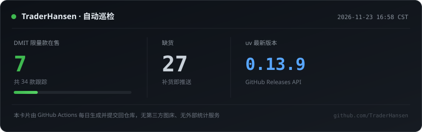

<div align="center">

### littlehush-art

把开源项目拆开看清楚，再把它们拼成每天真在用的东西。

<sub>量化 / 交易系统 · AI agent 工具链 · 拿 CI 当基础设施</sub>

<br>


</div>

---

## 实时状态



> 卡片由 GitHub Actions 每日 09:17 生成并提交回仓库。抓的是公开数据源（DMIT 库存站、GitHub Releases API），
> 没有第三方图床、没有外部统计服务、不依赖任何 token。

---

## 最近在折腾

| 仓库 | 说明 |
|---|---|
| [awesome-open-source-trading](https://github.com/littlehush-art/awesome-open-source-trading) | 450+ 开源交易/回测/Kalshi·Polymarket/期权/AI agent 项目 + 110 篇带收益数据的量化论文索引 |
| [claude-code-rust](https://github.com/littlehush-art/claude-code-rust) | Claude Code 的 Rust 重写版：启动快 2.5x，二进制小 97% |
| [Quant-Developers-Resources](https://github.com/littlehush-art/Quant-Developers-Resources) | 量化开发 / 研究 / 交易岗的技能与面试资源 |

---

## 这套卡片是怎么来的

```
GitHub Actions（每日 09:17，非整点避开排队）
   └─ scripts/gen_card.py     抓 dmitea 库存 + GitHub Releases API
        └─ 写 assets/status.svg
             └─ 提交回仓库  →  README 里的  直接引用
```

几个刻意的选择：

- **不用第三方统计卡**（github-readme-stats 那类）：公共实例经常 503，且数据要过别人的服务器。自己画一张 5KB 的 SVG，永远不挂。
- **提交回仓库 = 保活**：顺带解决「60 天没提交的定时任务会被停用」这条坑。
- **抓公开数据源**：卡片上只出现公开库存与版本号，不放任何私人数据。

<details>
<summary>为什么主页大多是 fork</summary>

<br>

fork 是有目的的收藏而非展示：看到值得拆的项目就 fork 下来读源码、跑通、再决定要不要重写。
真正的产出都落在私有仓库里（量化管道、agent 工具链），公开的部分挑了三个索引类仓库摆出来。

</details>
